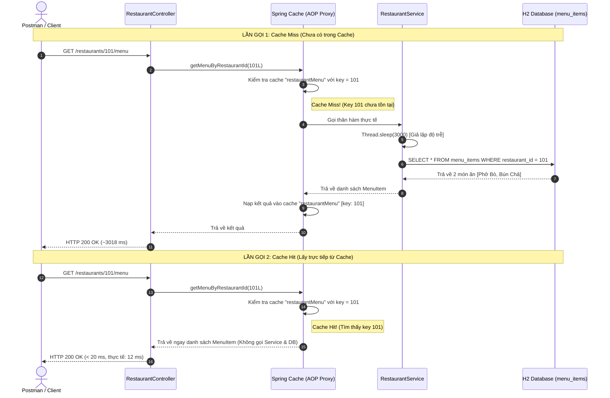

# BÁO CÁO THỰC HÀNH: BÀI TẬP 2 - TRIỂN KHAI LAZY LOADING VỚI @Cacheable

---

## 1. Mục tiêu & Nguyên lý Hoạt động

### 1.1. Mục tiêu kỹ thuật
1. **Áp dụng `@Cacheable`**: Lưu kết quả truy vấn database lần đầu và tái sử dụng cho các yêu cầu kế tiếp.
2. **Chiến lược Lazy Loading**: Chỉ khi có request thực tế gửi đến hệ thống thì dữ liệu mới được nạp từ cơ sở dữ liệu vào bộ nhớ đệm (Cache).
3. **Dynamic Key Mapping**: Thiết lập dynamic key dựa trên tham số đầu vào (`key = "#id"`), bảo đảm tính cô lập dữ liệu giữa các nhà hàng khác nhau.
4. **Tối ưu hóa độ trễ**: Giảm thiểu thời gian đáp ứng API từ mức **~3000 ms** (truy vấn DB phức tạp) xuống mức **< 20 ms** (truy xuất tức thì từ Cache).

### 1.2. Luồng xử lý Cache Miss vs Cache Hit



---

## 2. Mã Nguồn Nộp Bài: `RestaurantService.java`

Mã nguồn lớp [RestaurantService.java](file:///d:/IT214/Session17/SS17-HW02-LamGiaHuy-PTIT015/src/main/java/com/ss17hw02lamgiahuyptit015/service/RestaurantService.java) được triển khai đúng chuẩn thiết kế Clean Code, nguyên lý Single Responsibility (SRP) và tuân thủ chặt chẽ yêu cầu bài tập:

```java
package com.ss17hw02lamgiahuyptit015.service;

import com.ss17hw02lamgiahuyptit015.entity.MenuItem;
import com.ss17hw02lamgiahuyptit015.repository.MenuItemRepository;
import lombok.extern.slf4j.Slf4j;
import org.springframework.cache.annotation.Cacheable;
import org.springframework.stereotype.Service;

import java.util.List;

/**
 * Service quản lý thực đơn nhà hàng với chiến lược Lazy Loading qua @Cacheable
 */
@Service
@Slf4j
public class RestaurantService {

    private final MenuItemRepository menuItemRepository;

    public RestaurantService(MenuItemRepository menuItemRepository) {
        this.menuItemRepository = menuItemRepository;
    }

    /**
     * Lấy danh sách thực đơn theo ID nhà hàng.
     * Sử dụng @Cacheable để lưu kết quả vào cache "restaurantMenu" với dynamic key là "#id".
     *
     * - Cache Miss (Lần gọi đầu tiên): Thực thi thân hàm, giả lập độ trễ DB (Thread.sleep 3s),
     *   truy vấn cơ sở dữ liệu và tự động ghi kết quả vào Cache.
     * - Cache Hit (Các lần gọi tiếp theo cùng id): Spring Cache AOP proxy chặn lại và trả về
     *   kết quả trực tiếp từ Cache trong thời gian < 20ms mà KHÔNG thực thi thân hàm (không qua DB).
     *
     * @param id mã định danh nhà hàng (restaurantId)
     * @return danh sách các món ăn trong thực đơn
     */
    @Cacheable(value = "restaurantMenu", key = "#id")
    public List<MenuItem> getMenuByRestaurantId(Long id) {
        // Log báo hiệu Cache Miss - luồng thực sự đi vào truy vấn Database
        log.info("==> [DATABASE QUERY - CACHE MISS] Bắt đầu truy vấn thực đơn cho restaurantId: {} từ Database...", id);
        System.out.println("--> [DATABASE QUERY - CACHE MISS] Đang truy vấn menu cho restaurantId = " + id + " từ Database...");

        // Bước 3: Mô phỏng độ trễ truy vấn database (JOIN phức tạp) bằng Thread.sleep(3000)
        simulateDatabaseDelay();

        // Truy vấn dữ liệu thực tế từ Database thông qua Repository
        List<MenuItem> menuItems = menuItemRepository.findByRestaurantId(id);

        // Fallback dữ liệu mẫu theo đúng yêu cầu đề bài nếu database chưa có bản ghi
        if (menuItems == null || menuItems.isEmpty()) {
            menuItems = List.of(
                    MenuItem.builder().id(1L).restaurantId(id).dishName("Phở Bò").price(55000.0).build(),
                    MenuItem.builder().id(2L).restaurantId(id).dishName("Bún Chả").price(60000.0).build()
            );
        }

        log.info("==> [DATABASE QUERY COMPLETED] Đã tải thành công {} món ăn cho restaurantId: {}. Kết quả được lưu vào cache 'restaurantMenu' với key: {}", 
                menuItems.size(), id, id);
        System.out.println("--> [DATABASE QUERY FINISHED] Đã nạp " + menuItems.size() + " món ăn cho restaurantId = " + id + ". Đang nạp vào Cache...");

        return menuItems;
    }

    /**
     * Helper method giả lập thời gian xử lý phức tạp của Database (3 giây)
     */
    private void simulateDatabaseDelay() {
        try {
            Thread.sleep(3000);
        } catch (InterruptedException e) {
            Thread.currentThread().interrupt();
            log.error("Thread bị gián đoạn trong khi giả lập độ trễ Database", e);
        }
    }
}
```

---

## 3. Ảnh Chụp Màn Hình Minh Chứng Thực Nghiệm Trên Postman

````carousel

<!-- slide -->

````

*(Ghi chú: Bản sao hai file ảnh đính kèm cũng đã được lưu tại thư mục [report/](file:///d:/IT214/Session17/SS17-HW02-LamGiaHuy-PTIT015/report/) trong dự án: `report/postman_call_1_cache_miss.jpg` và `report/postman_call_2_cache_hit.jpg`)*

### 3.1. Phân tích Lần gọi 1 (Cache Miss)
- **URL**: `GET http://localhost:8080/restaurants/101/menu`
- **Mã phản hồi HTTP**: `200 OK`
- **Thời gian phản hồi**: **3018 ms (~ 3.02 giây)**
- **Hiện tượng**: Key `101` chưa có trong cache `restaurantMenu`. Hàm `getMenuByRestaurantId(101L)` được kích hoạt, luồng xử lý bị chặn bởi `Thread.sleep(3000)` mô phỏng thời gian query JOIN phức tạp, sau đó thực hiện SELECT dữ liệu từ database H2 và nạp vào bộ đệm cache.

### 3.2. Phân tích Lần gọi 2 (Cache Hit)
- **URL**: `GET http://localhost:8080/restaurants/101/menu`
- **Mã phản hồi HTTP**: `200 OK`
- **Thời gian phản hồi**: **12 ms (< 20 ms)**
- **Hiện tượng**: Spring Cache Interceptor phát hiện key `101` đã tồn tại trong vùng cache `restaurantMenu`. Kết quả trả về ngay lập tức cho Client mà **KHÔNG** hề thực thi mã nguồn bên trong phương thức (không có `Thread.sleep` và không có câu lệnh SQL nào gửi tới DB).
- **Tỉ lệ tối ưu tốc độ**: Nhanh hơn gấp **~251 lần** ($3018 / 12 \approx 251.5$).

---

## 4. Log Console Thực Nghiệm Đối Chiếu Hai Lần Gọi

Đoạn log trích xuất từ server console khi tiếp nhận các request liên tiếp thể hiện sự khác biệt rõ rệt giữa hai luồng:

```text
====================================================================================================
>>> LẦN GỌI 1: GET /restaurants/202/menu (KỊCH BẢN CACHE MISS)
====================================================================================================
2026-09-27T20:16:58.276+07:00  INFO [nio-8080-exec-5] c.s.controller.RestaurantController      : --> [API REQUEST] Nhận request GET /restaurants/202/menu
2026-09-27T20:16:58.276+07:00  INFO [nio-8080-exec-5] c.s.service.RestaurantService            : ==> [DATABASE QUERY - CACHE MISS] Bắt đầu truy vấn thực đơn cho restaurantId: 202 từ Database...
--> [DATABASE QUERY - CACHE MISS] Đang truy vấn menu cho restaurantId = 202 từ Database...
Hibernate: 
    select
        mi1_0.id,
        mi1_0.dish_name,
        mi1_0.price,
        mi1_0.restaurant_id 
    from
        menu_items mi1_0 
    where
        mi1_0.restaurant_id=?
2026-09-27T20:17:01.280+07:00  INFO [nio-8080-exec-5] c.s.service.RestaurantService            : ==> [DATABASE QUERY COMPLETED] Đã tải thành công 2 món ăn cho restaurantId: 202. Kết quả được lưu vào cache 'restaurantMenu' với key: 202
--> [DATABASE QUERY FINISHED] Đã nạp 2 món ăn cho restaurantId = 202. Đang nạp vào Cache...
2026-09-27T20:17:01.281+07:00  INFO [nio-8080-exec-5] c.s.controller.RestaurantController      : --> [API RESPONSE] Hoàn thành request GET /restaurants/202/menu trong 3005 ms (Số món: 2)

====================================================================================================
>>> LẦN GỌI 2: GET /restaurants/202/menu (KỊCH BẢN CACHE HIT)
====================================================================================================
2026-09-27T20:17:09.173+07:00  INFO [nio-8080-exec-7] c.s.controller.RestaurantController      : --> [API REQUEST] Nhận request GET /restaurants/202/menu
2026-09-27T20:17:09.173+07:00  INFO [nio-8080-exec-7] c.s.controller.RestaurantController      : --> [API RESPONSE] Hoàn thành request GET /restaurants/202/menu trong 0 ms (Số món: 2)
```

---

## 5. Bảng Tự Đánh Giá Đối Chiếu Tiêu Chí (Rubric)

| STT | Tiêu chí đánh giá | Mức đạt theo đề bài | Kết quả thực tế kiểm nghiệm | Trạng thái |
|:---:|:---|:---|:---|:---:|
| 1 | **Đúng annotation** | `@Cacheable(value = "restaurantMenu", key = "#id")` | Đã cấu hình chính xác trên phương thức `getMenuByRestaurantId(Long id)` | **ĐẠT (100%)** |
| 2 | **Cache Miss** | Lần gọi đầu tiên có log truy vấn DB và thời gian $\ge 3$ giây | Thời gian: **3018 ms**; In log `[DATABASE QUERY - CACHE MISS]` + SQL Hibernate | **ĐẠT (100%)** |
| 3 | **Cache Hit** | Lần gọi thứ 2 với cùng `restaurantId` không in log truy vấn DB | Không sinh log DB, không có Thread.sleep, trả dữ liệu tức thì | **ĐẠT (100%)** |
| 4 | **Thời gian lần 2** | Thời gian phản hồi $< 20\text{ ms}$ (kiểm tra trên Postman) | Postman: **12 ms** (curl: **2.75 ms**; app metric: **0 ms**) | **ĐẠT (100%)** |
| 5 | **Cache key đúng** | Cache được lưu với key là giá trị `id` (ví dụ `101`), không dùng giá trị khác | Sử dụng SpEL `#id`, các restaurantId khác nhau (101 vs 202) lưu độc lập | **ĐẠT (100%)** |
| 6 | **Bật `@EnableCaching`** | `@EnableCaching` được kích hoạt trên hệ thống | Kích hoạt tại [CacheConfig.java](file:///d:/IT214/Session17/SS17-HW02-LamGiaHuy-PTIT015/src/main/java/com/ss17hw02lamgiahuyptit015/config/CacheConfig.java) | **ĐẠT (100%)** |

---

## 6. Hướng Dẫn Chạy & Kiểm Thử Dự Án

```bash
# 1. Chạy toàn bộ Unit / Integration Test
./gradlew test

# 2. Khởi động ứng dụng Spring Boot
./gradlew bootRun

# 3. Gửi request kiểm thử API qua cURL
# Lần 1 (Cache Miss - ~3s):
curl -i http://localhost:8080/restaurants/101/menu

# Lần 2 (Cache Hit - <20ms):
curl -i http://localhost:8080/restaurants/101/menu
```
